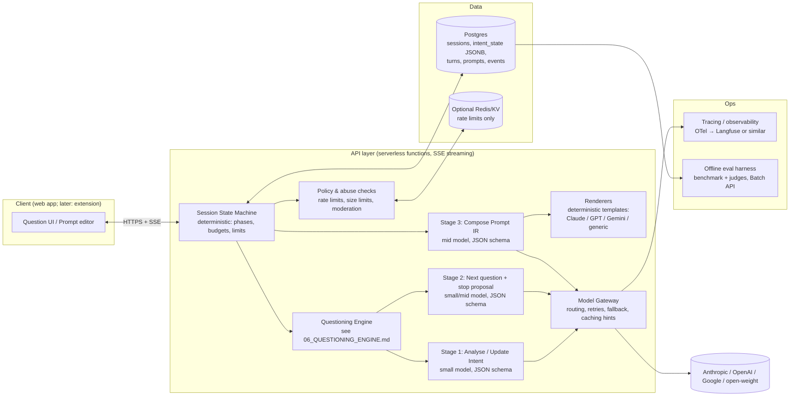

# 08 — Technical Architecture

**Workstream:** WS6 (Technical architecture & evaluation) · **Date:** 2026-11-13 (all "accessed" dates are this date unless stated) · **Companion:** `09_EVALUATION_FRAMEWORK.md` · **Sources:** `sources/WS6_sources.md`
**Scope note:** WS5 owns the questioning engine's internal algorithm (`06_QUESTIONING_ENGINE.md`). This document treats the engine as a component ("decide what to ask next / whether to stop") and designs the system around it. WS8 owns privacy/legal; security notes here are engineering controls only.

---

## 0. Summary of key findings

1. **LLM inference cost is not the constraint; latency, question quality and evaluation are.** With current list prices, a full session (analyse → 4 question turns → compose) costs **≈ $0.003 on Claude Haiku 5.5**, **≈ $0.020 with Haiku 5.5 + Sonnet 5.5 for composition**, and **≈ $0.059 on Sonnet 5.5 / GPT-6.1 Sol throughout** (worked example §9; prices from [Anthropic pricing](https://platform.claude.com/docs/en/about-claude/pricing) and [OpenAI pricing](https://developers.openai.com/api/docs/pricing)). Each extra question turn adds ≈ $0.0005 on a small model. **Verified prices; token counts are Hypothesis** (no product exists to measure yet).
2. **Recommended architecture: E (hybrid) — a deterministic state machine that owns the session flow and persists an explicit intent state, calling 2–3 narrowly-scoped, schema-constrained LLM stages.** Not multi-agent. Not an autonomous agent loop. The only problem that justifies more than one LLM call is that *question generation must be fast and composition must be good*, which favour different model tiers. (Hypothesis, argued in §3.)
3. **The strongest research support for the core mechanism is not "asking questions" but "consolidating information into one fully-specified prompt."** In Laban et al. (2025), all tested LLMs dropped **39%** on average when information arrived over multiple underspecified turns, while concatenating the same information into one prompt recovered **95.1%** of fully-specified performance ([arXiv 2505.06120](https://arxiv.org/abs/2505.06120), [HTML](https://arxiv.org/html/2505.06120)). **Verified.** This supports architecting SubText as "gather state → emit one consolidated prompt" rather than a chat that coaches the user turn by turn.
4. **Disconfirming evidence on "more requirements = better prompts":** Yang et al. (2025/26) found that adding all requirements to a prompt *does not consistently help* (instruction-following limits, conflicts), and standard prompt optimizers gave little benefit ([arXiv 2505.13360](https://arxiv.org/abs/2505.13360)). **Verified.** The composer must select and prioritise, not dump every answer; evaluation must control for length (see 09).
5. **All three major providers now offer schema-constrained ("structured") output**, which makes stage outputs machine-checkable: Anthropic (`output_config.format`, stable, constrained decoding) ([docs](https://platform.claude.com/docs/en/build-with-claude/structured-outputs)), OpenAI (`text.format` json_schema `strict`) ([docs](https://developers.openai.com/api/docs/guides/structured-outputs)), Gemini (`response_format` with JSON schema; some keywords silently stripped) ([docs](https://aistudio.google.com/docs/structured-output)). **Verified.** Schema feature support differs (e.g., Anthropic rejects `minLength`/numeric bounds; Gemini strips some), so schemas must be written to the lowest common denominator and validated in code.
6. **Prompt caching barely matters for cost at this scale but matters for latency and for small system prompts.** Anthropic's 5.5-generation models cache prefixes from **512 tokens** ([docs](https://platform.claude.com/docs/en/build-with-claude/prompt-caching)); OpenAI GPT-5.6+ from **1,024** ([docs](https://developers.openai.com/api/docs/guides/prompt-caching)); Gemini implicit caching needs **4,096** tokens on current models ([docs](https://aistudio.google.com/docs/caching)) — so SubText's ~1.5–2.5k-token stage prompts would **not** be cached on Gemini. **Verified.**
7. **Browser extension = fragile and ToS-exposed; ship a web app first.** Extensions that inject into chatgpt.com have repeatedly broken on UI changes (e.g., AIPRM, Sept 2023 — [Dataconomy](https://dataconomy.com/2023/09/18/aiprm-for-chatgpt-not-working-fix) `[snippet only]`), and OpenAI's Terms list "Automatically or programmatically extract data or Output" among prohibited uses ([Dec-2024 ToS mirror](https://open.windriver.com/info/uni-license-list/licenses/openai-tou-20241211.html), verified on mirror; current openai.com page returned 403). An extension limited to *inserting* text into a composer (no reading of outputs) is lower risk; WS8 should confirm.
8. **Tooling-vendor churn is a real 2026 risk.** Helicone was acquired by Mintlify and put into maintenance mode (Mar 2026); Langfuse acquired by ClickHouse (Jan 2026); promptfoo acquired by OpenAI (Mar 2026) ([developersdigest summary](https://www.developersdigest.tech/blog/llm-observability-acquisitions-2026), secondary; promptfoo via [OpenAI announcement](https://openai.com/index/openai-to-acquire-promptfoo/) `[snippet only]`). LiteLLM's PyPI package was compromised with a credential stealer on 2026-03-24 ([FutureSearch](https://futuresearch.ai/blog/litellm-pypi-supply-chain-attack/)). **Verified (secondary for acquisitions).** Prefer OpenTelemetry-based, self-hostable, version-pinned components.

**Bottom line for a 1–3 person team:** TypeScript web app (Next.js or similar) on a serverless platform, Postgres with JSONB session state, one primary LLM provider plus one fallback via a thin provider abstraction (e.g., Vercel AI SDK), Langfuse-style tracing, and an eval harness built *before* the product UI. Estimated 8–14 weeks to a measured MVP (§12). This is a Hypothesis about effort, not a commitment.

### Verified vs. claimed vs. hypothesis — how to read this document
- **Verified** = I read the primary page (pricing, docs, paper abstract/HTML) on 2026-11-13.
- **Claimed** = vendor self-description (framework marketing, "N providers supported").
- **Hypothesis** = my engineering judgement or estimates (token counts, latency targets, effort). All cost/latency numbers that depend on token counts are Hypothesis until measured in Phase 0.

---

## 1. Requirements that drive the architecture

Derived from the product thesis (AGENT_BRIEF) — not yet validated by WS3/WS4.

| # | Requirement | Architectural consequence |
|---|---|---|
| R1 | Turn-level interactivity: user waits for the next question | Question turn must be fast: target p50 ≤ 1.5 s to first visible token, p95 ≤ 3.5 s full question (Hypothesis; §10) |
| R2 | Questions must be *adaptive*, *material*, and stop when value < friction | Explicit, inspectable intent state; stop decision is a first-class output, not implied by chat |
| R3 | Final prompt must be high quality and target-model aware | Composition stage on a stronger model; provider-neutral prompt representation + deterministic renderers |
| R4 | User can review, edit, copy, export | Prompt versions stored; edit diff captured as a quality signal |
| R5 | Must be measurable (09) | Every LLM call traced with inputs/outputs/model version; session replayable deterministically from stored state |
| R6 | Small team, low ops | Serverless, managed Postgres, few moving parts; no self-hosted GPU |
| R7 | Privacy-sensitive inputs (users paste business context) | Data minimisation, retention controls, provider zero-retention options where available (WS8) |
| R8 | Survive model churn (new models every few months) | Model choice is configuration; prompts per stage versioned; eval gate before switching |

---

## 2. LLM landscape relevant to SubText (Nov 2026)

### 2.1 Current prices (USD per 1M tokens, standard tier, accessed 2026-11-13)

| Provider / model | Input | Cached input (read) | Cache write | Output | Notes | Source |
|---|---|---|---|---|---|---|
| **Anthropic Claude Haiku 5.5** (≤100k-token prompts) | $0.10 | $0.01 | $0.125 (5-min) / $0.20 (1-h) | $0.50 | >100k prompts: $0.50/$2.50; "Fastest" comparative latency | [pricing](https://platform.claude.com/docs/en/about-claude/pricing), [models](https://platform.claude.com/docs/en/about-claude/models/overview) |
| Anthropic Claude Sonnet 5.5 | $2.00 | $0.10 | $2.50 / $4.00 | $10.00 | Cache reads 0.05× base; thinking cannot be fully disabled (Models API reports `disabled.supported=false`) | same |
| Anthropic Claude Opus 5.5 | $4.00 | $0.20 | $5.00 / $8.00 | $20.00 | Anthropic's default recommendation for most workloads | same |
| **OpenAI gpt-6-luna** | $0.10 | $0.01 | $0.125 (30-min) | $0.50 | Short context ≤272k | [pricing](https://developers.openai.com/api/docs/pricing) |
| OpenAI gpt-6.1-terra | $1.00 | $0.05 | $1.25 | $5.00 | | same |
| OpenAI gpt-6.1-sol | $2.00 | $0.10 | $2.50 | $10.00 | | same |
| OpenAI gpt-6-astra | $10.00 | $1.00 | $12.50 | $50.00 | Flagship; not needed for SubText stages | same |
| **Google Gemini 3.5 Flash-Lite** | $0.30 | $0.03 | implicit only | $2.50 | Output price incl. thinking | [pricing](https://aistudio.google.com/docs/pricing) |
| Google Gemini 3.8 Flash | $0.75 (→ $1.50 from 2027-01-01) | $0.075 | implicit only | $3.75 (→ $7.50) | Announced price doubling in 2027 | same |
| Google Gemini 4 Hydrogen | $1.50 | $0.075 | — | $7.50 | | same |
| Google Gemini 4 Carbon / Argon | $2.00 (→ $4.00 from 2026-12-01) | $0.10 | — | $10.00 (→ $20.00) | Price doubles in 18 days | same |
| **Open-weight: gpt-oss-120b on Groq** | $0.15 | — | — | $0.60 | Groq lists 500 tok/s | [Groq models](https://console.groq.com/docs/models) |
| Open-weight: gpt-oss-20b on Groq | $0.075 | — | — | $0.30 | 1,000 tok/s | same |

**Batch / flex:** Anthropic Batch API is 50% off input and output and stacks with caching ([pricing](https://platform.claude.com/docs/en/about-claude/pricing)); OpenAI Batch and Flex tables are ~50% of Standard (e.g., gpt-5.4-mini $0.375/$2.25 vs $0.75/$4.50) — the page lists tables but does not state a percentage ([pricing](https://developers.openai.com/api/docs/pricing)); Gemini Batch/Flex ≈ 50% ([pricing](https://aistudio.google.com/docs/pricing)). Batch is irrelevant to the interactive path but **halves offline evaluation and judging costs**.

**Observations (Hypothesis unless marked):**
- Small-tier prices have converged at ~$0.10/$0.50 (Haiku 5.5, gpt-6-luna) — **Verified**. The choice between them should be made on *measured question quality and latency on our benchmark*, not price.
- Google's announced price doublings (Gemini 4 Carbon/Argon from 2026-12-01; 3.8 Flash from 2027-01-01) are a reminder that **prices are not monotonically falling** — **Verified** from the pricing page. Design for model swap.
- Anthropic's newer tokenizer (Claude 4.7+) "produces approximately 30% more tokens for the same text" ([pricing](https://platform.claude.com/docs/en/about-claude/pricing)) — **Verified**. Per-token prices are therefore not directly comparable across providers; compare *cost per session* measured on the same transcripts.

### 2.2 Latency characteristics

- Anthropic labels Haiku 5.5 "Fastest", Sonnet 5.5 "Fast", Opus 5.5 "Moderate" ([models overview](https://platform.claude.com/docs/en/about-claude/models/overview)) — **Verified (qualitative)**.
- Artificial Analysis reports Claude Haiku 5.5 (max-effort variant) at **256 output tokens/s** ([model page](https://artificialanalysis.ai/models/claude-haiku-5-5)); Groq lists gpt-oss-120b at 500 tok/s ([Groq](https://console.groq.com/docs/models)). **Verified figures, but third-party/benchmark conditions.**
- The Artificial Analysis leaderboard's "first answer token" times for *maximum reasoning-effort* variants are tens to hundreds of seconds ([leaderboard](https://artificialanalysis.ai/leaderboards/models); my extraction from this page was partly ambiguous, so treat as indicative only). **Design implication (Hypothesis): reasoning effort, not model size, dominates interactive latency. Interactive stages must run at low/no thinking effort**; Anthropic exposes an `effort` parameter and adaptive thinking on all current models ([models overview](https://platform.claude.com/docs/en/about-claude/models/overview)).

### 2.3 Structured outputs per provider (Verified from docs)

| Capability | Anthropic | OpenAI | Google Gemini |
|---|---|---|---|
| Mechanism | `output_config.format` (`json_schema`) + `strict: true` tools; constrained decoding; status stable | `text.format` `json_schema` + `strict: true`; function calling for tools | `response_format` with `mime_type: application/json` + `schema` |
| Guarantee | "Always valid… Guaranteed field types and required fields" | Schema adherence for completed, non-refusal outputs; must handle `refusal` and incomplete outputs | Syntactically valid JSON; "always validate values in your application" |
| Not supported / caveats | No recursive schemas, no `minimum`/`maximum`, no `minLength`/`maxLength`, `additionalProperties` must be `false`; first use adds grammar-compile latency (cached 24 h); changing the format invalidates the prompt cache | Some JSON Schema features unsupported; first request with a new schema has extra latency | Silently strips `minLength`, `maxLength`, `uniqueItems`, etc.; overly complex schemas → 400 |
| Source | [docs](https://platform.claude.com/docs/en/build-with-claude/structured-outputs) | [docs](https://developers.openai.com/api/docs/guides/structured-outputs) | [docs](https://aistudio.google.com/docs/structured-output) |

**Implication:** Write stage schemas as flat objects with enums, required fields and `additionalProperties: false`; enforce numeric/length bounds in code (Zod/Pydantic) after the call. Keep schemas stable (schema changes cost latency and cache).

### 2.4 Prompt caching (Verified from docs)

| | Anthropic | OpenAI (GPT-5.6+) | Gemini |
|---|---|---|---|
| Activation | Automatic (top-level `cache_control`) or explicit breakpoints (max 4) | Implicit by default, or explicit `prompt_cache_breakpoint` | Implicit by default (2.5+); explicit caching not on Gemini 4 |
| Minimum prefix | 512 tokens on 5.5-gen models; 1,024–4,096 on older | 1,024 tokens | 4,096 tokens on current models |
| TTL | 5 min default; 1 h option | 30 min default; 12 h option | n/a (implicit) |
| Write cost | 1.25× (5 min) / 2× (1 h) | 1.25× (30 min) / 2.5× (12 h) | none |
| Read cost | 0.1× (0.05× on Sonnet/Opus 5.5) | 0.1× (0.05× on GPT-6.1 Sol/Terra) | ~0.1× (from price table) |
| Source | [docs](https://platform.claude.com/docs/en/build-with-claude/prompt-caching) | [docs](https://developers.openai.com/api/docs/guides/prompt-caching) | [docs](https://aistudio.google.com/docs/caching) |

**Implication:** Put each stage's static instructions + few-shot examples first (stable prefix ≥ 512/1,024 tokens), dynamic state last. With steady traffic, cross-session cache hit rates on the static prefix should be high (Hypothesis: ≥ 90% at > 1 session per 5 min per stage). On Gemini, SubText's stage prompts are below the 4,096-token minimum, so no caching — a minor cost but noticeable latency difference.

### 2.5 Streaming
All three providers support streaming; Gemini explicitly supports streaming structured output as partial JSON ([docs](https://aistudio.google.com/docs/structured-output)). **Design:** stream the *question text field* to the UI as soon as it appears (place it first in the schema), and stream the composed prompt. Partial-JSON parsing is supported by the Vercel AI SDK and BAML (Claimed — [BAML docs](https://docs.boundaryml.com/home)).

---

## 3. Architecture options compared

All options assume the same UI and persistence; they differ in how reasoning is organised.

| Option | Description | Reliability | Cost / session (4 Q) | Latency per Q-turn | Build complexity | Maintainability | Accuracy potential | Verdict |
|---|---|---|---|---|---|---|---|---|
| **A. One LLM does everything** | Single prompt per turn: "given conversation, either ask next question(s) or output final prompt" | Medium-low: stop decisions and output format drift; state is implicit in chat history (the multi-turn "lost in conversation" failure mode, [Laban et al.](https://arxiv.org/abs/2505.06120)) | Low if small model; high if frontier model needed for composition quality | Bound by the model chosen for composition (slow if strong) | Lowest | Low: one giant prompt, hard to test parts | Capped by one model's trade-off | **Build as the baseline (T3/T4-lite in eval), not as the product** |
| **B. Multiple specialised LLM stages (pipeline)** | Analyse → gap-detect → question-gen → answer-integrate → compose → self-critique, each an LLM | Medium: more calls = more failure points, but each testable | Medium (more calls) | Can be high if stages are serial | Medium | Medium-high | High | Partly adopt (2–3 stages, not 6) |
| **C. Deterministic state machine + LLM-assisted reasoning** | Code owns flow, limits, stop rules, budgets; LLM fills structured slots | High: invariants enforced in code (max questions, required fields) | Low | Low | Medium | High | Depends on how much judgement is pushed into code; rigid rules ask irrelevant questions | Adopt as the skeleton |
| **D. Agentic (LLM decides tools/steps in a loop)** | Agent with tools: ask_user, update_state, compose, search… | Low-medium: unbounded loops, variable turn count; hard to guarantee latency | Unpredictable | Unpredictable | Medium | Low (emergent behaviour) | High ceiling, low floor | **Reject** — no identified problem requires autonomous planning |
| **D′. Multi-agent (critic/planner/writer agents)** | Several LLM "personas" deliberating | Low; compounds latency | 2–5× | 2–5× | High | Low | Unproven for this task | **Reject** — no clearly identified problem it solves |
| **E. Hybrid (recommended)** | C as skeleton + B's best split: (1) *Analyse/Update* (small model), (2) *Next-question + stop proposal* (small/mid model; engine logic per WS5), (3) *Compose* (mid model) → deterministic renderer | High | ≈ $0.003–0.02 (§9) | ≤ 1.5 s p50 target | Medium | High (each stage has own eval) | High | **Recommend** |

**Why E over A (the key decision):** A is cheaper to build, and Phase 0 should build it to see if it is good enough. E is preferred if A shows any of these measurable defects on the benchmark: (i) stop decisions that ignore the question budget; (ii) composition quality that requires a model too slow for question turns; (iii) state loss across turns (answers not reflected in the final prompt — measurable as "requirement recall", see 09). These are known failure modes ([Laban et al.](https://arxiv.org/abs/2505.06120): early assumptions, premature final answers, over-reliance on them; [ClarifyMT-Bench](https://arxiv.org/abs/2512.21120): "consistent under-clarification bias", degradation with dialogue depth). **Verified literature; their applicability to SubText is Hypothesis to be tested in Phase 0.**

**Precedent for E:** IN3 / Mistral-Interact put a clarification model *upstream* of an executing agent, judging vagueness, asking, and converting answers into concrete goals — improving goal precision and reducing unnecessary tool calls ([Qian et al. 2024](https://arxiv.org/abs/2402.09205)). **Verified (abstract).** SubText is structurally the same pattern, with a human-pasted prompt as the hand-off.

---

## 4. Recommended high-level architecture



ASCII fallback:

```
 Browser ──HTTPS/SSE──► Session State Machine (code) ──► Postgres (session + intent_state JSONB)
                              │
                ┌─────────────┼───────────────────────┐
                ▼             ▼                       ▼
     Stage 1 Analyse/   Stage 2 Next Q +        Stage 3 Compose → Prompt IR
     Update (small LLM) stop proposal (small/   (mid LLM)        │
                        mid LLM; WS5 engine)                     ▼
                └──────────► Model Gateway ◄──────── Deterministic renderers
                             (retry, fallback,        (Claude / GPT / Gemini / generic)
                              cache hints)
                                   │
                                   ▼
                     Providers  ──► OTel traces ──► Observability ──► Offline eval harness
```

### 4.1 Component responsibilities

| Component | Responsibility | Deterministic or LLM | Notes |
|---|---|---|---|
| **Session State Machine** | Phases: `intake → analysing → asking ⇄ awaiting_answer → composing → review → done`; enforces max questions, max turns, timeouts, "skip/just write it" escape hatch, idempotency per turn | Deterministic | The *final* stop decision lives here: `stop = engine_proposes_stop OR budget_exhausted OR user_requests`. Keeps behaviour bounded even if the LLM misbehaves. |
| **Questioning Engine** | Chooses which information gap to ask about, question form (multiple choice / free text / confirm assumption), estimates value of asking vs. stopping | Mixed (WS5) | Interface contract only here: input = intent_state; output = `{action: ask|stop, question?, options?, target_slots[], rationale, expected_value}` |
| **Stage 1 Analyse/Update** | Initial: classify task type (taxonomy from WS2), extract known slots, list gaps/assumptions/contradictions. Each answer: integrate into state, mark slots filled, detect new gaps | LLM (small), schema-constrained | Run with low effort. Cheap enough to run every turn. |
| **Stage 2 Next question** | Generate the user-facing question text + options per engine decision | LLM (small or mid) | Could be merged with Stage 1 into one call per turn to save a round trip (Hypothesis: test both). |
| **Stage 3 Compose** | Produce a provider-neutral **Prompt IR**: role, objective, audience, context, constraints, inputs, output format, quality bar/success criteria, examples (if any), explicit assumptions, open questions for the downstream model | LLM (mid tier) | Must *prioritise* — evidence that dumping all requirements can hurt ([Yang et al.](https://arxiv.org/abs/2505.13360)). |
| **Renderers** | Convert Prompt IR into target-specific text (e.g., XML-tagged sections for Claude, markdown sections for GPT, etc.) and a generic version | Deterministic templates | Cheap, unit-testable, versioned. Whether target-specific formatting matters is a WS2 question and an A/B in 09; default to a robust generic format until proven. |
| **Model Gateway** | Single interface to providers; per-stage model config; retries with jitter; fallback chain; timeouts; cost accounting; cache-friendly prompt assembly | Code (library) | A library (e.g., AI SDK provider layer, LiteLLM SDK, Pydantic AI) rather than a separately-operated proxy at MVP. |
| **Policy & abuse** | Input size caps, per-user/IP rate limits, moderation on input (optional), prompt-injection hygiene, spend caps | Code + optional moderation API | Main abuse vector: using SubText as a free LLM proxy. |
| **Persistence** | Sessions, versioned intent states, turns, prompts, events, feedback | Postgres | §7 |
| **Observability** | Trace every LLM call (stage, model ID, prompt version, tokens, latency, cost, cache hits) | OTel-based | §11 |
| **Eval harness** | Offline benchmark runs, judge pipelines, regression gates | Code + Batch APIs | See 09 |

### 4.2 Data flow for one session

1. `POST /v1/sessions {raw_request, target_model?}` → State machine creates session, runs **Stage 1** (analyse) → stores `intent_state v1` → calls engine.
2. Engine returns `ask` → **Stage 2** streams question (SSE) → state `awaiting_answer`.
3. `POST /v1/sessions/:id/turns {answer | skip | "just write it"}` → **Stage 1 (update)** integrates answer → `intent_state v(n+1)` → engine decides ask/stop → repeat 2–3.
4. On stop: **Stage 3** compose → Prompt IR stored → renderer produces target text → streamed to the editor.
5. User edits/copies/exports → `POST /v1/events` captures `copy`, `export`, `edit_diff`, `regenerate`, `thumbs`. These are the production eval signals (09 §9).
6. All LLM calls traced; state versions allow **deterministic replay** of a session against a new model/prompt version for regression testing.

**Latency optimisations (Hypothesis, to test):** (a) merge Stage 1-update and Stage 2 into one call; (b) ask 2–3 independent questions per screen to cut round trips (WS4/WS5 decide UX); (c) for multiple-choice questions, speculatively pre-compute the next engine step for the most likely option while the user reads; (d) run composition at low effort with streaming.

---

## 5. Conversation / intent state schema (draft)

To be reconciled with WS5's engine design. Intentionally provider-neutral and versioned. Stored as JSONB; validated with a schema library on every write.

```jsonc
{
  "schema_version": "0.1",
  "session_id": "uuid",
  "state_version": 7,                       // increments on every update; immutable history kept
  "phase": "asking",                        // intake|analysing|asking|awaiting_answer|composing|review|done|abandoned
  "raw_request": "Build me a website for my business",
  "target": { "model_family": "claude|gpt|gemini|generic", "use_surface": "chat|api|agent", "user_selected": true },
  "task": {
    "type": "software.website",             // WS2 taxonomy id
    "type_confidence": 0.82,
    "deliverable": "multi-page marketing site plan + copy",
    "complexity": "medium"
  },
  "slots": [                                // the intent model: what we know / need
    {
      "id": "audience",
      "label": "Who the site is for",
      "status": "filled|inferred|assumed|missing|conflicting|not_applicable",
      "value": "local homeowners in Leeds",
      "source": "user_answer|raw_request|inferred|default",
      "confidence": 0.9,
      "materiality": "high|medium|low",     // how much it changes the output (engine estimate)
      "evidence_turn_ids": ["t3"]
    }
  ],
  "assumptions": [ { "id": "a1", "text": "No e-commerce needed", "confirmed": false, "risk": "medium" } ],
  "contradictions": [ { "slot_ids": ["budget","scope"], "description": "...", "resolved": false } ],
  "questions_asked": [
    { "turn_id": "t3", "slot_targets": ["audience"], "form": "multiple_choice|free_text|confirm",
      "text": "...", "options": ["..."], "answer": "...", "skipped": false,
      "asked_at": "ts", "answered_at": "ts", "answer_ms": 9400, "engine_expected_value": 0.31 }
  ],
  "budget": { "max_questions": 6, "asked": 3, "user_patience_signal": "normal|low", "elapsed_ms": 61000 },
  "stop": { "proposed_by_engine": false, "reason": null, "final_reason": null },
  "prompt_ir_id": null,                     // set after composition
  "model_trace": [ { "stage": "analyse", "model": "claude-haiku-5-5", "prompt_version": "analyse@1.4.0", "trace_id": "..." } ]
}
```

**Prompt IR (output of Stage 3):**

```jsonc
{
  "ir_version": "0.1",
  "objective": "...", "role": "...", "audience": "...",
  "context": ["..."], "inputs_to_provide": ["..."],
  "constraints": [{ "text": "...", "priority": "must|should|nice" }],
  "output_spec": { "format": "markdown|json|table|code|prose", "length": "...", "structure": ["..."] },
  "quality_criteria": ["..."], "examples": [], 
  "assumptions_stated": ["..."], "ask_downstream_model_to_clarify": ["..."],
  "techniques_applied": ["decomposition","examples","self-check"]   // WS2 decides which; hidden from user
}
```

Rendered prompts are stored per renderer version, so we can evaluate renderer changes independently of composition changes.

---

## 6. API requirements (endpoints)

| Method & path | Purpose | Notes |
|---|---|---|
| `POST /v1/sessions` | Create session from raw request (+ optional target model, task hint) | Returns first engine action; supports SSE (`Accept: text/event-stream`) |
| `GET /v1/sessions/:id` | Fetch session, current state, latest prompt | Owner-only |
| `POST /v1/sessions/:id/turns` | Submit answer / skip / "just write it" / edit previous answer | Idempotency key header; returns next action (stream) |
| `POST /v1/sessions/:id/compose` | Force composition now (user override) | |
| `POST /v1/sessions/:id/prompts/:pid/render` | Re-render IR for another target model | Deterministic; no LLM call |
| `PATCH /v1/prompts/:pid` | Save user edits (new version) | Store diff for edit-distance metric |
| `POST /v1/events` | Client telemetry: copy, export, open-in-target, thumbs, abandon | Batched; privacy-filtered |
| `POST /v1/feedback` | Explicit rating + optional comment, optional "how did the downstream answer turn out?" | |
| `GET /v1/me/sessions` / `DELETE /v1/sessions/:id` | History; user-initiated deletion | Hard delete + cascade (WS8 retention policy) |
| `GET /v1/health`, `/v1/config/models` | Ops; which models/targets available | |
| Internal: `POST /internal/eval/replay` | Replay stored sessions against a new config | Admin only; for regression |

Auth: session cookie (web) or bearer token (extension). Anonymous trial sessions allowed with stricter rate limits (Hypothesis: important for activation; WS4/WS7 decide).

---

## 7. Database considerations

**Choice: managed Postgres** (e.g., Neon, Supabase, RDS) with JSONB for evolving state. Rationale: relational data (users, sessions, prompts, events) + flexible state documents; one system to operate; strong transactional guarantees for per-turn updates. **Redis is optional** — only for rate limiting / short-lived locks; a serverless KV or Postgres advisory locks suffice at MVP scale. (Hypothesis; standard practice.)

Schema sketch:

```sql
users(id uuid pk, email citext unique, created_at, plan, data_region, deleted_at)
sessions(id uuid pk, user_id fk null, anon_id text null, created_at, updated_at,
         phase text, task_type text, target_family text, n_questions int,
         status text, client text,            -- web|extension|api
         retention_until timestamptz)
intent_states(session_id fk, version int, state jsonb, created_at,
              primary key(session_id, version))   -- append-only; replayable
turns(id uuid pk, session_id fk, idx int, kind text, -- question|answer|skip|override
      payload jsonb, latency_ms int, created_at)
llm_calls(id uuid pk, session_id fk, stage text, provider text, model_id text,
          prompt_version text, input_tokens int, cached_tokens int, output_tokens int,
          reasoning_tokens int, cost_usd numeric(10,6), latency_ms int, ttft_ms int,
          status text, trace_id text, created_at)
prompt_irs(id uuid pk, session_id fk, ir jsonb, composer_version text, created_at)
rendered_prompts(id uuid pk, ir_id fk, renderer text, renderer_version text,
                 text text, parent_id fk null, edited_by_user bool, created_at)
events(id bigserial, session_id fk, user_id fk null, type text, props jsonb, created_at)
feedback(id uuid pk, session_id fk, rating smallint, outcome text, comment text, created_at)
api_keys(id uuid pk, user_id fk, provider text, ciphertext bytea, key_last4 text,
         kms_key_id text, created_at, revoked_at)   -- only if BYOK server-side
```

Notes: GIN index on `intent_states.state` only if querying inside state is needed (prefer denormalised columns on `sessions`). Partition `events`/`llm_calls` by month when large. Row-level security (Supabase) or app-level ownership checks. Separate analytics copy with redacted text for eval sampling (WS8 consent).

---

## 8. Model orchestration strategy

### 8.1 Stage → model routing (initial hypothesis, to be decided by Phase 0 evals)

| Stage | Requirements | Primary candidate | Alternates to benchmark | Effort setting |
|---|---|---|---|---|
| Analyse/Update (classify, slot extraction, gaps) | Fast, reliable JSON, good at implicit-requirement detection | Claude Haiku 5.5 | gpt-6-luna; Gemini 3.5 Flash-Lite; gpt-oss-120b (Groq) | low / thinking off where allowed |
| Next question (+ stop proposal) | Fast; *question quality is the product* | Claude Haiku 5.5 | Sonnet 5.5 at low effort; gpt-6.1-terra; gpt-6-luna | low |
| Compose (Prompt IR) | Highest quality; ≤ ~8 s with streaming | Claude Sonnet 5.5 or gpt-6.1-terra | Opus 5.5; Gemini 4 Hydrogen; Haiku 5.5 (budget tier) | low–medium |
| Render | n/a | deterministic | — | — |
| Judge (offline only) | Different family from generator to limit self-preference ([Panickssery et al.](https://arxiv.org/abs/2404.13076)) | ≥2 judges from different providers, frontier tier, via Batch | Prometheus 2 (open evaluator) as a cheap cross-check ([Kim et al.](https://arxiv.org/abs/2405.01535)) | medium–high |

Default stance: **one primary provider for all interactive stages** (simplifies caching, latency tuning and data-processing agreements), **a second provider as fallback**, and cross-provider judges offline.

### 8.2 Fallbacks and resilience
- Per-stage timeout (e.g., 6 s for question stages, 25 s for compose) → one retry on the same provider with jitter for 429/5xx → fallback to the alternate provider's equivalent tier with the same schema (schemas written to lowest common denominator, §2.3).
- **Graceful degradation:** if question generation fails twice, the state machine proceeds to compose with explicit assumptions listed (user still gets a prompt). If composition fails, return a deterministic template render of the current state.
- **Model version pinning:** use pinned snapshot IDs. Anthropic states every Claude model ID is a pinned snapshot from the 4.6 generation on ([models overview](https://platform.claude.com/docs/en/about-claude/models/overview)); retirement dates are published (e.g., Haiku 5.5 "not sooner than October 7, 2027"). Model upgrades go through the eval gate (09 §8).

### 8.3 Gateways and frameworks (don't presume a stack)

| Option | What it is | Fit for SubText | Risks | Evidence |
|---|---|---|---|---|
| **Direct provider SDKs** | Official SDKs, each with schema helpers (Pydantic/Zod) | Good: only 2–3 stages, 1–2 providers | Some duplication across providers | Anthropic SDK helpers ([docs](https://platform.claude.com/docs/en/build-with-claude/structured-outputs)); OpenAI ([docs](https://developers.openai.com/api/docs/guides/structured-outputs)) — Verified |
| **Vercel AI SDK** (TypeScript) | Unified API for text, structured objects, tool calls, agents across providers | Strong fit for a TS web app: streaming + provider swap | Fast-moving majors (v6/v7 in 2026, conflicting reports); deprecation churn around `generateObject`/`streamObject` reported by third parties | [ai-sdk.dev](https://ai-sdk.dev/docs/introduction) (Claimed); version history from [search](https://doolpa.com/news/vercel-ai-sdk-6-agents-mcp-devtools-may-4-2026) `[snippet only]` |
| **Pydantic AI** (Python) | Typed agent loop, "every model a string swap away", structured output, Temporal/DBOS durability, Pydantic Evals, OTel | Strong fit for a Python backend | Agent abstraction is more than needed | [docs](https://pydantic.dev/docs/ai/overview/) (Claimed) |
| **Instructor** (Python) | Pydantic-validated structured extraction with retries | Fine for stage calls | Mostly superseded by native structured outputs | Secondary comparisons only ([glukhov.org](https://www.glukhov.org/post/2025/12/baml-vs-instruct-for-structured-output-llm-in-python/) `[snippet only]`) |
| **BAML** | DSL for typed LLM functions; streaming typed partials; playground; works with open models | Useful if many prompt functions and multiple languages | Extra build step; v0→v1 language transition noted in docs | [docs](https://docs.boundaryml.com/home) (Claimed) |
| **LangGraph** | Graph orchestration with checkpointers (Postgres), interrupts for human-in-the-loop, durable execution | Over-powered: SubText turns are short request/response; our state machine + Postgres covers it | Framework lock-in; abstractions | [LangGraph durable execution / persistence](https://docs.langchain.com/oss/python/langgraph/durable-execution) — Verified |
| **Mastra** (TypeScript) | Agents, tools, model router (`provider/model` strings), Studio | Plausible TS alternative | Younger ecosystem | [docs](https://mastra.ai/docs) (Claimed) |
| **DSPy** | Signatures/modules + optimizers (e.g., GEPA, MIPROv2) that tune prompts against a metric and labelled examples | **Phase 3**: optimise stage prompts *offline* once the benchmark and metric exist | Needs a trustworthy metric; risk of overfitting the judge | [dspy.ai](https://dspy.ai/) — Verified description |
| **OpenRouter** | Hosted multi-provider router; no inference markup; 5.5% credit-purchase fee; BYOK fee 5% beyond $25k/month | Great for Phase-0 model bake-offs | Extra hop, extra data processor | [FAQ](https://openrouter.ai/docs/faq) — Verified |
| **LiteLLM** | SDK + self-hosted OpenAI-compatible proxy; 100+ providers; fallbacks, budgets, cost tracking, logging callbacks | Useful if Python; proxy adds ops | **Supply-chain compromise 2026-03-24** (v1.82.7/1.82.8 credential stealer) | [docs](https://docs.litellm.ai/docs/) (Claimed); [incident](https://futuresearch.ai/blog/litellm-pypi-supply-chain-attack/) |
| **Portkey** | Hosted AI gateway (routing, guardrails, observability) | Optional | Additional vendor | Not researched in depth (no primary source read) |

**Recommendation (Hypothesis):** TypeScript end-to-end (UI + API) with the Vercel AI SDK *or* direct SDKs behind a ~200-line internal `ModelClient` interface; no LangGraph; no self-hosted proxy at MVP; OpenRouter only for evaluation bake-offs. If the team is Python-first, FastAPI + Pydantic AI is an equally good choice. The decisive factor is team skill, not framework features.

### 8.4 Model-specific prompt renderers
- Composition produces the IR once; renderers are pure functions `render(ir, target, renderer_version) → string`.
- Renderer variants: `claude` (sectioned with XML-style tags), `gpt` (markdown headers, explicit output schema), `gemini`, `generic` (plain sections), plus *surface* variants (chat vs. API system+user split vs. agent/IDE).
- **Evidence status:** Provider prompting guides differ in conventions (WS2 owns); there is limited independent evidence that target-specific formatting changes outcomes materially for modern models. **Hypothesis to test** with a renderer A/B in the offline benchmark (09 §4.6). Until then, ship `generic` as default and target-specific as an option.

---

## 9. Cost estimation methodology and worked example

### 9.1 Method
`cost_session = Σ_stages Σ_calls [ sys_tokens × (h·p_read + (1−h)·p_write) + dyn_tokens × p_in + out_tokens × p_out ] / 10^6`
where `sys_tokens` is the static, cacheable stage prefix, `h` the steady-state cache hit rate on that prefix, `dyn_tokens` the per-call dynamic input (state, answers), and `out_tokens` includes reasoning/thinking tokens (billed as output by all three providers; Gemini's table explicitly says "output price (including thinking)" — [pricing](https://aistudio.google.com/docs/pricing)).

### 9.2 Token assumptions (Hypothesis — replace with Phase-0 measurements)

| Stage | Calls/session | Static prefix (cacheable) | Dynamic input | Output (visible + thinking) |
|---|---|---|---|---|
| S1 Analyse | 1 | 1,500 | 150 | 400 + 300 = 700 |
| S2 Question turn *t* (includes answer integration) | N (number of question turns) | 2,000 | 700 + 250·t (state grows) | 250 + 300 = 550 |
| S3 Compose | 1 | 2,500 | 1,200 | 700 + 800 = 1,500 |

Totals: N=4 → 17,650 input / 4,400 output tokens per session. Cache hit rate `h = 0.9` on static prefixes. Gemini: prefixes < 4,096 tokens → no caching (priced at full input).

### 9.3 Worked arithmetic — Config B (Haiku 5.5 for S1/S2, Sonnet 5.5 for S3), N = 4

Prices: Haiku 5.5 $0.10 in / $0.125 5-min write / $0.01 read / $0.50 out; Sonnet 5.5 $2.00 / $2.50 / $0.10 / $10.00 ([Anthropic pricing](https://platform.claude.com/docs/en/about-claude/pricing), accessed 2026-11-13).

- **S1 (Haiku):** sys 1,500 × (0.9×0.01 + 0.1×0.125) = 1,500 × 0.0215 = 32.25; dyn 150 × 0.10 = 15; out 700 × 0.50 = 350 → 397.25 /10⁶ = **$0.000397**
- **S2 t=0 (Haiku):** 2,000 × 0.0215 = 43; 700 × 0.10 = 70; 550 × 0.50 = 275 → **$0.000388**
- **S2 t=1:** 43 + 95 + 275 → **$0.000413**; **t=2:** 43 + 120 + 275 → **$0.000438**; **t=3:** 43 + 145 + 275 → **$0.000463**
- **S3 (Sonnet):** 2,500 × (0.9×0.10 + 0.1×2.50) = 2,500 × 0.34 = 850; 1,200 × 2.00 = 2,400; 1,500 × 10.00 = 15,000 → 18,250 /10⁶ = **$0.018250**
- **Total ≈ $0.02035 per session.** Composition is ~90% of the cost; the four question turns together cost ~$0.0017.

### 9.4 Sensitivity to number of question turns (USD per session)

| Config | N=0 | N=2 | N=4 | N=6 | N=8 | Marginal per extra Q-turn |
|---|---|---|---|---|---|---|
| A: all Claude Haiku 5.5 | 0.0013 | 0.0021 | **0.0030** | 0.0040 | 0.0051 | ≈ $0.0005 |
| B: Haiku 5.5 + Sonnet 5.5 compose | 0.0187 | 0.0195 | **0.0204** | 0.0214 | 0.0225 | ≈ $0.0005 |
| C: all Claude Sonnet 5.5 | 0.0261 | 0.0417 | **0.0594** | 0.0790 | 0.1007 | ≈ $0.0098 |
| D: gpt-6-luna + gpt-6.1-terra compose | 0.0095 | 0.0103 | **0.0112** | 0.0122 | 0.0133 | ≈ $0.0005 |
| E: all gpt-6.1-sol | 0.0261 | 0.0417 | **0.0594** | 0.0790 | 0.1007 | ≈ $0.0098 |
| F: Gemini 3.5 Flash-Lite + 3.8 Flash compose (no caching) | 0.0106 | 0.0151 | **0.0198** | 0.0249 | 0.0302 | ≈ $0.0025 |
| G: gpt-oss-120b on Groq (no caching) | 0.0021 | 0.0036 | **0.0053** | 0.0071 | 0.0091 | ≈ $0.0009 |
| H: all Claude Opus 5.5 | 0.0521 | 0.0834 | **0.1188** | 0.1581 | 0.2014 | ≈ $0.0197 |

(Computed by script from the §9.2 assumptions and the §2.1 prices. Gemini 3.8 Flash prices double on 2027-01-01, which would roughly raise F's composition cost 2×.)

**Scale illustration (Config B, N=4):** 10k sessions/month ≈ $204; 100k ≈ $2,035; 1M ≈ $20,350. Config A: 1M sessions ≈ $3,000.

### 9.5 What this means
- **Inference cost per question is ~0.05 cents on small models** — the economic case for "fewer questions" is entirely about *user time and friction*, not compute. This should inform WS5's stopping rule (the cost term is human, see 09 §6).
- Costs not included: the downstream LLM answer (the user runs the prompt in their own ChatGPT/Claude — zero cost to us unless we add "run it here"); abuse traffic (rate limits essential: a free proxy to Sonnet would be expensive); evaluation costs (09 §10, dominated by human raters, not tokens); hosting/DB (likely < $100/month at MVP scale — Hypothesis).
- **Risk check:** If composition requires reasoning effort "high", thinking tokens could be 3–10× the visible output, pushing Config B to ~$0.05–0.15/session. Still small, but latency would be unacceptable (§10) — another reason to keep effort low and test quality impact.

---

## 10. Latency budget per turn (targets are Hypothesis)

Perceived-latency targets (to validate with WS4): question turn feels "instant" if first text appears < ~1.5 s.

| Segment | Question turn (p50 / p95) | Compose (p50 / p95) | Notes |
|---|---|---|---|
| Client → API (edge/region) | 50 / 150 ms | 50 / 150 ms | Single region close to provider endpoints |
| Auth, load state from Postgres, policy checks | 30 / 100 ms | 30 / 100 ms | Pooled connection; one row + latest state |
| LLM time-to-first-token (low effort, cached prefix) | 400 / 1,200 ms | 600 / 2,000 ms | Provider/load dependent; caching reduces TTFT |
| LLM generation | 250 tokens @ ~150–250 tok/s ≈ 1.0–1.7 s (question text streamed first, so perceived ≈ TTFT + ~0.3 s) | 700 visible tokens @ 80–200 tok/s ≈ 3.5–9 s streamed; + thinking 800 tokens ≈ 4–10 s if not suppressed | Haiku 5.5 ~256 tok/s ([AA](https://artificialanalysis.ai/models/claude-haiku-5-5)) |
| Persist state + trace (async) | 20 / 80 ms | 20 / 80 ms | Off the critical path (`waitUntil`) |
| **Total to first visible question token** | **≈ 0.6–0.9 s / ≤ 2 s** | — | |
| **Total to complete question** | **≈ 1.5–2.5 s / ≤ 3.5 s** | — | |
| **Total to complete prompt** | — | **≈ 5–10 s / ≤ 20 s** | Stream; show structure skeleton immediately |

If Stage 1 (update) and Stage 2 (question) run as separate serial calls, question-turn latency roughly doubles — hence the merge experiment in §4.2. Serverless limits are not binding: Vercel functions default to 300 s max duration and bill active CPU only (waiting on LLM I/O is not billed as CPU) ([Vercel limits](https://vercel.com/docs/functions/limitations)); Cloudflare Workers don't count time waiting on `fetch()` toward CPU time and have no hard wall-clock limit while the client is connected ([Cloudflare limits](https://developers.cloudflare.com/workers/platform/limits/)). **Verified.**

---

## 11. Observability

Trace each LLM call with: stage, provider, pinned model ID, prompt version, input/cached/output/reasoning tokens, cost, TTFT, total latency, schema-validation result, fallback used, session/turn IDs. Use OpenTelemetry instrumentation so the backend is swappable.

| Tool | Status (Nov 2026) | Fit | Source |
|---|---|---|---|
| **Langfuse** | Open source, self-hostable free; Cloud: Hobby free (50k units), Core $29, Pro $199, Enterprise $2,499; $8 per extra 100k units. Acquired by ClickHouse (Jan 2026, secondary source); core MIT outside `ee/` per secondary source | **Recommended default** (self-host or Core) | [pricing](https://langfuse.com/pricing) Verified; ownership [secondary](https://www.developersdigest.tech/blog/llm-observability-acquisitions-2026) |
| LangSmith | No ownership change; self-host enterprise-only | Good if using LangChain | secondary (same) |
| Braintrust | Evals + logging; self-host enterprise-only | Strong eval UX; consider for 09 | secondary (same) |
| Helicone | Acquired by Mintlify, maintenance mode (Mar 2026) | **Avoid for new builds** | secondary (same); vendor blog URL returned 404 |
| Pydantic Logfire | OTel-native; pairs with Pydantic AI | If Python | [Pydantic AI docs](https://pydantic.dev/docs/ai/overview/) (Claimed) |

Dashboards: p50/p95 latency per stage; schema-failure rate; fallback rate; cost/session; questions/session distribution; skip rate; "just write it" rate; copy rate; edit distance (09 §9).

---

## 12. Security considerations (engineering; legal/policy → WS8)

| Risk | Control |
|---|---|
| **Cost abuse / free-proxy use** (users pasting arbitrary tasks to get Sonnet output) | Output is a *prompt*, not an answer: composer instructed never to perform the task; per-user/IP rate limits; daily spend caps per account; input length caps (e.g., 8k chars raw request, 2k per answer); anomaly alerts on cost/session |
| **Prompt injection via user content** | Low stakes (user can only affect their own session) but: treat user text as data inside delimited fields; never give the LLM tools with side effects; schema-constrained outputs limit damage; do not render model output as HTML |
| **Sensitive data in requests** (business plans, personal info) | Data minimisation; configurable retention (e.g., 30 days default, delete on request); encrypt at rest (managed DB default); redact before analytics; use provider zero-data-retention/no-training options where eligible (Anthropic notes ZDR eligibility for structured outputs is "qualified" — [docs](https://platform.claude.com/docs/en/build-with-claude/structured-outputs)); data residency options carry ~10% uplift on Anthropic (`inference_geo: "us"` 1.1×) and OpenAI (regional processing +10%) ([Anthropic](https://platform.claude.com/docs/en/about-claude/pricing), [OpenAI](https://developers.openai.com/api/docs/pricing)) |
| **Supply chain** | Pin dependency versions with lockfiles + hashes; avoid running unvetted proxies; the LiteLLM compromise ([FutureSearch](https://futuresearch.ai/blog/litellm-pypi-supply-chain-attack/)) shows LLM tooling is a target; secrets in a managed secret store, never in CI logs |
| **BYOK key handling** | Prefer client-side-only BYOK in the extension (key in extension storage, calls direct to provider) or server-side envelope encryption with KMS; never log keys; show last-4 only. Anthropic browser calls require the `anthropic-dangerous-direct-browser-access` header, suitable for BYOK but exposes the key to the device ([Willison](https://simonwillison.net/2024/Aug/23/anthropic-dangerous-direct-browser-access)) |
| **Account security** | Use a managed auth provider (magic link / OAuth), no password storage; session cookies `HttpOnly`/`SameSite` |
| **Extension permissions** | Request `activeTab` + on-demand `scripting` rather than broad host permissions; content scripts run in an isolated world but share the page DOM ([Chrome docs](https://developer.chrome.com/docs/extensions/develop/concepts/content-scripts)) |

---

## 13. Deployment strategy

| Option | Pros | Cons | Fit |
|---|---|---|---|
| **Vercel** (Next.js + Functions, Fluid compute) | Lowest friction for TS; streaming; 300 s default max; pay for active CPU; auto-scale to 30k concurrency on Hobby/Pro | Vendor coupling; costs at scale | **Recommended for MVP** ([limits](https://vercel.com/docs/functions/limitations)) |
| Cloudflare Workers | Cheap, global, fetch wait not billed as CPU, Workers Paid CPU up to 5 min | Non-Node runtime quirks; Postgres via Hyperdrive/HTTP drivers | Good alternative ([limits](https://developers.cloudflare.com/workers/platform/limits/)) |
| Fly.io / Render (containers) | Any language; long-lived processes | More ops | If Python backend |
| AWS (Lambda/ECS + RDS) | Enterprise credibility, Bedrock access to Claude, data residency | Highest ops burden for 1–3 people | Later, for enterprise tier |

Environments: `dev` / `staging` / `prod`; infrastructure as code; feature flags for model/prompt versions; canary new prompt versions to ~5% of traffic with eval-signal monitoring (09 §9).

**Scalability:** The workload is I/O-bound on provider APIs; the real scaling limits are **provider rate limits** (tokens/min per tier) and DB connections. Mitigate with: provider tier upgrades, a second provider, connection pooling, and backpressure (queue + "high demand" UI state). At 1M sessions/month (~0.4 sessions/s average, perhaps 5/s peak) this is a small system. (Hypothesis.)

---

## 14. Browser-extension architecture (later phase)

- **Manifest V3** model: service worker background, content scripts in an isolated world with DOM access, limited extension APIs in content scripts, messaging via `runtime.sendMessage`/`connect`, dynamic injection via `scripting` with host permissions or `activeTab` ([Chrome docs](https://developer.chrome.com/docs/extensions/develop/concepts/content-scripts)). **Verified.**
- **Fragility:** Injecting UI into chatgpt.com / claude.ai depends on undocumented DOM structure that changes without notice; ChatGPT extensions (AIPRM, Bulk Delete, Save GPT) have broken on UI updates ([search summary](https://dataconomy.com/2023/09/18/aiprm-for-chatgpt-not-working-fix) `[snippet only]`). Expect recurring maintenance; build selector health checks and a fallback "copy to clipboard" path.
- **ToS exposure:** OpenAI's Terms (Dec-2024 version, read via mirror) prohibit automatically or programmatically extracting data or Output ([mirror](https://open.windriver.com/info/uni-license-list/licenses/openai-tou-20241211.html)). An extension that *reads* conversation outputs (e.g., to measure re-ask rate) is materially riskier than one that only *writes* the prompt into the composer on user click. WS8 to assess current terms for OpenAI, Anthropic and Google.
- **Recommended extension design (Phase 3):** popup/side panel that runs the SubText session against our API; on completion, "Insert into ChatGPT/Claude/Gemini" uses `activeTab` + `scripting.executeScript` to set the composer text only after explicit click; never auto-submits; never reads responses. Distribution via Chrome Web Store requires review and a privacy disclosure.
- **Alternative with zero DOM dependency:** open the target product in a new tab with the prompt prefilled via URL parameter if supported. **Unverified** whether chatgpt.com/claude.ai currently support stable prefill parameters; also, putting user content in URLs leaks it to history and logs — likely unacceptable for sensitive prompts.

---

## 15. BYOK vs. hosted keys

| Dimension | Hosted keys (we pay) | BYOK |
|---|---|---|
| Unit cost to us | $0.003–0.06/session (§9) | ~$0 |
| Activation friction | None | High for non-technical users (most target users won't have API keys — WS3 to confirm) |
| Abuse risk | Must rate-limit | Shifted to user |
| Privacy posture | We are a processor of the content | Still processed by our backend unless fully client-side |
| Model choice | Ours | User's (harder to guarantee quality; eval coverage per model) |
| Implementation | Simple | Key storage/encryption, per-provider error handling, support burden |

**Recommendation (Hypothesis):** Hosted keys for all users at MVP (costs are negligible relative to any subscription price — WS7); BYOK only as an enterprise/power-user option later. OpenRouter supports BYOK with a 5% fee beyond a $25k monthly allowance ([FAQ](https://openrouter.ai/docs/faq)) if multi-provider BYOK is wanted without building it.

---

## 16. Implementation path for a 1–3 person team (phased; durations are Hypothesis)

| Phase | Weeks | Deliverables | Exit criteria |
|---|---|---|---|
| **0. Eval-first spike** | 1–3 | Benchmark v0 (≥ 60 tasks with hidden intent cards — 09 §4); user simulator; Architecture A baseline (single call) + T2/T3 baselines; judge pipeline; cost/latency/token logging; model bake-off via OpenRouter | We can score any pipeline end-to-end in < 1 h for < $50; first read on whether questions beat one-shot rewriting (09) |
| **1. MVP (web)** | 3–8 | Architecture E: state machine, Stage 1–3, generic + 2 target renderers, Postgres, auth (managed), rate limits, SSE streaming, Langfuse tracing, copy/export, events | p50 question latency ≤ 2 s; schema failure < 0.5%; offline benchmark win rate vs. T3 ≥ pre-registered threshold (09 §7) |
| **2. Measured beta** | 8–14 | Human study (09 §5); production eval signals; fallback provider; prompt caching tuned; prompt/version canarying; replay-based regression tests | Human-study result on primary metric; decision gate: continue / pivot / stop |
| **3. Expansion** | 14+ | Extension (insert-only), BYOK, history/templates, team features, DSPy/GEPA optimisation of stage prompts against benchmark, renderer A/B results | Driven by WS7 business case |

Staffing: 1 full-stack engineer can deliver Phases 0–1; a second person (eval/research) is the highest-leverage addition because **evaluation, not code, is the critical path**.

---

## 17. Unresolved questions

1. Actual token counts per stage and real cache hit rates (all §9 figures are modelled).
2. Whether Stage 1+2 can be merged without hurting question quality (latency vs. quality).
3. Which small model writes the best questions on our benchmark (Haiku 5.5 vs. gpt-6-luna vs. Flash-Lite vs. gpt-oss-120b); whether a mid-tier model is required for question generation.
4. Whether target-specific renderers improve downstream results at all for current frontier models.
5. Current (Nov 2026) ToS text for OpenAI/Anthropic/Google regarding extensions that insert into or read from their web UIs (current openai.com terms page returned 403 to my fetch).
6. Whether chatgpt.com / claude.ai / gemini.google.com support stable URL prefill parameters.
7. Provider rate limits at our expected tier (not researched; depends on account tier).
8. Reconciliation of the §5 state schema with WS5's engine (`06_QUESTIONING_ENGINE.md` not yet available when this was written).
9. Portkey and other hosted gateways were not evaluated from primary sources.

## 18. Validation experiments

| # | Experiment | Measure | Decision it informs |
|---|---|---|---|
| V1 | Instrumented Phase-0 runs on 60+ benchmark tasks | Tokens per stage, cost/session, TTFT, total latency | Replace §9/§10 assumptions |
| V2 | Small-model bake-off for Stage 2 | Question quality (09 rubric), latency, schema failures | Stage-2 model choice |
| V3 | Merge S1+S2 vs. separate | Latency delta; question quality delta | Pipeline shape |
| V4 | Architecture A vs. E on the benchmark | Requirement recall in final prompt, downstream win rate, stop-decision accuracy | Whether E's complexity is justified |
| V5 | Renderer A/B (generic vs. target-specific) across Claude/GPT/Gemini downstream | Downstream win rate | Whether to maintain multiple renderers |
| V6 | Effort level sweep for composition (none/low/medium) | Quality vs. latency vs. cost | Composition settings |
| V7 | Extension spike: insert-only on chatgpt.com/claude.ai; track breakages over 8 weeks | Selector break frequency; time to fix | Whether an extension is maintainable |
